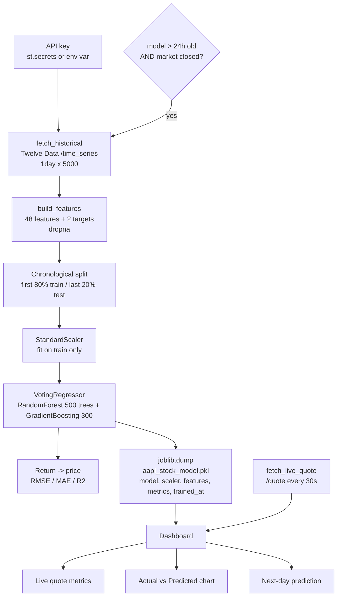

# Interview Study Guide: Stock Prediction Dashboard

This guide helps you explain and defend this project honestly. It is written for a beginner: every term is explained. **No performance numbers appear in it, because the app recomputes them on every retrain and none are stored in the repo.** If an interviewer asks "what was your RMSE?", give the honest answer: *"It changes with each retrain. More importantly, RMSE on price on its own doesn't prove anything. Here is how I'd evaluate it properly."* Then explain section 8.

Code references are `app.py:line`.

---

## 1. The 30-second explanation

> "I built a Streamlit dashboard that pulls daily stock data from the Twelve Data API, builds 48 features from technical indicators like moving averages, RSI, MACD and Bollinger Bands, and trains a Random Forest plus Gradient Boosting ensemble to predict tomorrow's **return**. It turns that return back into a price for the chart. I split the data chronologically to avoid look-ahead leakage. The biggest thing I learned is that a high R² on stock prices means almost nothing, because 'tomorrow equals today' already scores very high. The fair tests are beating that naive baseline and getting the direction right."

## 2. The 60-second explanation

> "The app fetches up to 5,000 days of daily open, high, low, close and volume data, called OHLCV, for a ticker. It engineers 48 features: moving averages and their ratios to the price, lagged returns, volatility, candlestick shape, RSI, MACD, Bollinger Bands and rate of change. The target is the next day's percentage return, not the next day's price. Returns are roughly on the same scale whether the stock is at $20 or $200, while prices keep drifting.
>
> I split the data 80/20 by time, so the model trains on the past and is tested on the future. The scaler is fitted on the training part only. The model is a VotingRegressor that averages a Random Forest and a Gradient Boosting model. The app shows a live quote, an actual-vs-predicted chart and a next-day forecast. It retrains automatically when the saved model is more than 24 hours old and the market is closed.
>
> When I reviewed it, I found two things to fix. The first was a hardcoded API key; I moved it to Streamlit secrets and the key has to be revoked. The second was the evaluation: price R² is close to trivial, so I documented that the fair evaluation is RMSE against a naive baseline plus directional accuracy. I also found some date-alignment bugs, which I can walk you through. It's a learning project, not trading advice."

---

## 3. Business problem and why it matters

- **Goal:** forecast the next day's closing price and show it on an interactive dashboard.
- **Who might care:** retail investors and analysts who want a quick technical-indicator view. In an interview, though, the honest framing is that this is a **time-series ML and engineering exercise**: API ingestion, feature engineering, leakage-safe evaluation, caching, retraining and secret handling.
- **Why it's hard:** the *efficient market hypothesis* says prices already reflect public information, so tomorrow's move is mostly unpredictable noise. Any real edge is small, and it disappears once trading costs are included.

---

## 4. Architecture and data flow



Step by step:
1. `get_api_key()` (`app.py:27-36`) reads the key from secrets or an environment variable.
2. `fetch_historical()` (`app.py:42-60`) downloads daily bars, sorts them by date and converts them to numbers.
3. `build_features()` (`app.py:98-129`) adds the indicators and the targets, then drops rows that contain NaN.
4. `train()` (`app.py:135-172`) splits, scales, fits, evaluates and saves.
5. The main dashboard (`app.py:277-337`) loads the model, predicts on all rows, and draws the chart and metrics.
6. The auto-refresh loop (`app.py:340-343`) sleeps 30 seconds and reruns while the market is open.

---

## 5. Dataset schema and data-quality checks

**Raw data (Twelve Data `time_series`, `interval=1day`, `outputsize=5000`):**

| Column | Meaning |
|---|---|
| Date | Trading day |
| Open / High / Low / Close | Price at the open, the day's high, the day's low, the closing price |
| Volume | Number of shares traded |

**Data-quality handling in the code:**
- `if "values" not in data: raise ValueError(...)` (`app.py:51-52`) turns an API error (bad key, rate limit, unknown ticker) into a clear message.
- `pd.to_numeric(..., errors="coerce")` (`app.py:57`) turns bad values into NaN instead of crashing.
- `sort_values("datetime")` (`app.py:55`): the API returns newest-first, so sorting is essential before any rolling calculation or time split.
- `dropna()` (`app.py:129`) removes the first ~50 rows, where the 50-day averages aren't defined yet, **and the last row**, whose target (tomorrow) is unknown. See bug B3 below.

**Checks that are missing (good things to mention):** duplicate dates, gaps (missing trading days), zero or negative prices, stock splits (a 4-for-1 split looks like a −75% "return" unless the prices are adjusted; check whether the API data is split-adjusted), and asserting that the dates are strictly increasing.

**The 48 features** (I verified the count by running `build_features` on a test frame):

| Group | Columns | Plain English |
|---|---|---|
| Raw price/volume | Open, High, Low, Close, Volume | Today's bar |
| Moving averages | SMA_5/7/10/21/50, EMA_5/7/10/21/50 | Average price over the last N days. EMA weights recent days more. |
| Ratios | Close_SMA{5,10,21,50}_ratio | Is the price above or below its average? Scale-free. |
| Lagged returns | Return_lag_{1,2,3,5,10} | % change over the last N days |
| Normalised lags | Close_lag_{1,2,3,5}_norm | Past close divided by today's close |
| Volume | Volume_SMA_10, Volume_ratio | Is today's volume unusual? |
| Momentum / ROC | Momentum_5/10, ROC_5/10/21 | % change over N days |
| Volatility | Volatility_10/21 | Standard deviation of daily returns. How jumpy the stock is. |
| Candlestick | Daily_Range, Body, Upper_Wick, Lower_Wick | Shape of the day's bar, divided by price |
| RSI | RSI_7, RSI_14 | 0–100. Above 70 is "overbought", below 30 is "oversold". |
| MACD | MACD, MACD_signal, MACD_hist (divided by Close) | Fast EMA minus slow EMA, a trend signal |
| Bollinger | BB_width, BB_pct | Band width (volatility) and where the price sits inside the bands |

**An honest observation:** some features are exact duplicates. `Momentum_5` equals `Return_lag_5`, and `ROC_5` is `100 × Return_lag_5` (I verified this numerically). The same holds for the 10-day versions. They add no information. Also, the raw price-level features (Close, SMA, EMA) are **not** scale-free, which partly undoes the README's "returns remove scale bias" argument (see Q8).

---

## 6. Code walkthrough in plain English

### 6.1 API key (`app.py:27-36`)
```python
def get_api_key() -> str:
    try:
        return st.secrets["TWELVE_DATA_API_KEY"]
    except Exception:
        key = os.environ.get("TWELVE_DATA_API_KEY")
```
The function tries Streamlit secrets first (`.streamlit/secrets.toml` locally, or the Secrets panel on Streamlit Cloud), then falls back to an environment variable. If neither is set, it shows a clear error and calls `st.stop()`. `.streamlit/secrets.toml` is in `.gitignore`.

**The story:** an earlier version had the key written directly in the code. It was removed in commit `327a473`. **Removing it from the code is not enough: the key is still in the git history, and anyone can read a public repo's history. The key must be revoked and replaced at Twelve Data.** If asked, say exactly that.

### 6.2 Indicators (`app.py:82-96`)
- `_rsi`: average gain divided by average loss over 14 days, turned into a 0–100 scale. The `+1e-9` avoids dividing by zero.
- `_macd`: 12-day EMA minus 26-day EMA, plus a 9-day "signal" average of that.
- `_bb`: the 20-day mean ± 2 standard deviations. It returns the band width and %B (the position inside the bands).

All of these use `.rolling()` or `.ewm()` over **past** rows only, so the features at day *t* don't peek at the future. That is correct.

### 6.3 Targets (`app.py:127-128`)
```python
df['Target_return'] = df['Close'].pct_change().shift(-1)   # tomorrow's % change
df['Target_price']  = df['Close'].shift(-1)                 # tomorrow's close
```
`shift(-1)` moves tomorrow's value up onto today's row. That is the only place future information appears, and both columns are excluded from the features (`app.py:138`).

### 6.4 Chronological split and scaling (`app.py:142-148`)
```python
split = int(len(X) * 0.8)
X_tr, X_te = X.iloc[:split], X.iloc[split:]
scaler = StandardScaler(); X_tr_s = scaler.fit_transform(X_tr); X_te_s = scaler.transform(X_te)
```
The first 80% of the days are for training and the last 20% for testing. The scaler learns its mean and std from the training part only, and then applies them to the test part. Both of these choices prevent leakage.

### 6.5 Model (`app.py:150-156`)
A `VotingRegressor` averages the predictions of:
- `RandomForestRegressor(n_estimators=500, max_depth=10, max_features=0.7, ...)`: many trees on random samples, with their outputs averaged.
- `GradientBoostingRegressor(n_estimators=300, learning_rate=0.05, max_depth=5, subsample=0.8)`: trees built one after another, each fixing the errors of the previous ones.

Averaging two different model types usually reduces variance.

### 6.6 Return back to price, and metrics (`app.py:158-165`)
```python
pred_returns = model.predict(X_te_s)
prev_closes  = df['Close'].iloc[split-1:-1].values
y_pred_price = prev_closes * (1 + pred_returns)
y_test_price = df['Target_price'].iloc[split:].values
```
The idea: predicted tomorrow's price = today's close × (1 + predicted return). **Look closely, though. This is bug B1 below.**

### 6.7 Auto-retraining (`app.py:178-186`, `app.py:246-251`)
```python
def market_is_closed() -> bool:
    now = datetime.now(ET)
    return now.weekday() >= 5 or now.hour >= 16
def model_is_stale(hours=24) -> bool:   # model file older than 24 h, or missing
```
On startup, if the model is stale **and** the market is closed, the app retrains with the latest data, shows a toast and clears the caches. The "Retrain Now" button (`app.py:230-237`) does the same on demand. Caching: `@st.cache_resource` keeps the loaded model in memory, and `@st.cache_data(ttl=3600)` keeps the feature table for 1 hour, so the API isn't called on every rerun.

---

## 7. Bugs and weak spots I found (know these cold, they show maturity)

Present these as "things I found reviewing my own code". Each one was checked against the code.

**B1. Off-by-one in the training metrics (`app.py:159`).**
For test row *t*, `pred_returns` estimates the change from Close(t) to Close(t+1), and `y_test_price` is Close(t+1). But `prev_closes` is Close(t−1), one day too early. The correct line is `df['Close'].iloc[split:].values`. As written, the "prediction" is based on a price two days before the target, which makes the RMSE look worse than the model really is.

**B2. Misaligned chart in the dashboard (`app.py:283-285`).**
`Predicted(t) = Close(t−1) × (1 + pred(t))`, but `pred(t)` is the forecast for t→t+1, not for t−1→t. To predict Close(t), you should use `pred(t−1)`, for example `df['Predicted'] = df['Close'].shift(1) * (1 + pd.Series(pred_returns).shift(1))`. The R²/RMSE in the "Model Performance" panel (`app.py:325-327`) inherits this problem.

**B3. The "next-day" prediction is one day stale (`app.py:129`, `app.py:313-315`).**
`dropna()` drops the newest row, because its target is unknown. So `df.tail(1)` is the *second-newest* day, and the forecast is for a day whose close is already known. (I verified this: on a 300-row test frame, the feature table ended one date before the raw data.) Fix: build the inference features without dropping on the target columns, for example `dropna(subset=features)`.

**B4. The model can be applied to the wrong ticker.**
The saved file stores `"ticker"`, but the dashboard never checks it. If you train on AAPL and then type MSFT, the AAPL model scores MSFT data. Fix: compare `meta["ticker"]` with the ticker in the box and retrain or warn.

**B5. The test window in the dashboard isn't the training test window.**
The dashboard re-downloads data and takes `int(len(df)*0.8)` again. If new days have arrived since training, the split point moves, and some "test" rows were actually training rows. Fix: store the split date in the pickle and use it.

**B6. Smaller issues.**
- The `period` selectbox (`app.py:210`) is never used.
- `market_is_closed()` treats 00:00–09:30 ET and market holidays as "open".
- The README mentions `train_model.py`, which isn't in the repo.
- On Streamlit Cloud the filesystem is temporary, so the `.pkl` can disappear and two visitors could trigger retraining at the same time.
- `time.sleep(30)` blocks that session's script.
- Each 30-second refresh makes a quote API call, which uses up the free daily quota quickly.

How to talk about it: *"These are exactly the bugs time-series code is prone to: alignment between features, targets and base prices. The fix is to write a tiny test with a hand-made 5-row price series where I know the right answer."* (Exercise 3.)

---

## 8. Metrics, and why R² on price is near-trivial

| Metric | Formula | Meaning |
|---|---|---|
| RMSE | √(mean((actual − predicted)²)) | Typical error in dollars. Big misses count extra. |
| MAE | mean(\|actual − predicted\|) | Average error in dollars |
| R² | 1 − SS_res / SS_tot | Share of variance explained, compared with predicting the mean |
| **Directional accuracy** (not implemented) | share of days where sign(predicted return) = sign(actual return) | Did we get up vs down right? 50% is a coin flip. |
| **Skill vs naive** (not implemented) | 1 − RMSE_model / RMSE_naive | > 0 means we beat "tomorrow = today" |

**Why R² on price is almost meaningless.** R² compares your error with the error of predicting the *average* price over the test period. A stock that went from $150 to $230 has a huge spread around its average. Any prediction that just stays close to yesterday's price follows the trend line and wipes out most of that spread. So the naive forecast "tomorrow's price = today's price" already scores a very high R² (the README says around 0.99 for this kind of data; check it yourself in Exercise 1). Any model that outputs a tiny return times yesterday's price inherits that score for free.

**A fairer evaluation:**
1. Compute the naive baseline RMSE: `rmse(Close[t+1], Close[t])`. The model must beat it.
2. Compute directional accuracy on the returns, and compare it with always guessing "up" (stocks rise a little more often than they fall, so the honest baseline is the up-day share, not 50%).
3. Evaluate on **returns**, for example the correlation between predicted and actual returns.
4. Use walk-forward validation (train on years 1–3, test on year 4; then train on 1–4, test on 5), not a single split.
5. If you claim it's useful for trading, include transaction costs.

**What to say about the numbers in the app:** *"The app shows R² and RMSE, but I wouldn't use them as evidence the model works. I'd need to show it beats the naive RMSE and gets the direction right more often than the base rate. I haven't measured that yet. It's the next improvement, and it's in the README."*

---

## 9. Key concepts explained

**Returns vs prices.** A *return* is the % change: (today − yesterday) / yesterday. Prices trend and change scale over the years (non-stationary), while returns stay roughly in the same range (closer to stationary). Tree models **cannot extrapolate**: if the test prices are higher than anything seen in training, a tree predicting price can never output a value above its training maximum. Predicting returns avoids that.

**Chronological vs random split (leakage).** A random split puts days from 2025 in training and days from 2024 in testing. The model then "knows the future": rolling features of neighbouring days overlap, and it learns the regime of the test period. That gives scores that are too optimistic. A chronological split matches real use, where you only ever know the past.

**Look-ahead bias.** Any feature that uses information not available at prediction time. `shift(-1)` on a feature (instead of the target), or `.rolling(center=True)`, would cause it. This code uses only backward-looking windows.

**Ensemble (VotingRegressor).** It averages the predictions of different models. If their errors aren't perfectly correlated, the average is more stable.

**StandardScaler with trees.** Trees don't need scaling. It is harmless here, and fitting it on the training part only is still the correct habit.

**Market efficiency.** If a simple indicator reliably predicted tomorrow, traders would exploit it until it stopped working. So expect directional accuracy close to the base rate. That expectation is a sign of understanding, not failure.

---

## 10. Why each technology was chosen

| Tech | Why | Alternative |
|---|---|---|
| Twelve Data API | Live quotes plus daily history, free tier | yfinance (unofficial), Alpha Vantage, Polygon |
| pandas | Rolling windows and EWM in one line | Polars |
| scikit-learn RF + GB + VotingRegressor | Strong tabular models, little tuning needed | XGBoost/LightGBM; ARIMA/Prophet for classic time series; LSTM (in the future-work list) |
| Streamlit | A dashboard in pure Python, free hosting on Streamlit Cloud, built-in secrets and caching | Dash, Flask + JS |
| Plotly | Interactive zoom/hover charts | matplotlib (static) |
| joblib | Save the model, scaler and metadata together | pickle, skops |
| st.secrets / env var | Keys kept out of code and out of git | A cloud secret manager |

---

## 11. Testing and validation

What exists:
- A chronological hold-out.
- The scaler fitted on train only.
- API error checks.
- `errors="coerce"` for bad numbers.
- Staleness checks for retraining.

What doesn't exist: no automated tests, no naive baseline, no directional accuracy, no walk-forward validation.

What you would add:
1. **An alignment unit test.** Feed a 10-row price series that rises exactly 1% per day. Then `Target_return` must be 0.01 on every row, and a perfect model's reconstructed price must equal `Target_price`. This test would catch B1, B2 and B3.
2. **A leakage test.** Change only the last row's Close, and assert that no feature on earlier rows changes.
3. **A baseline test.** Report `rmse_model / rmse_naive` and fail loudly if the model is worse.

---

## 12. Limitations and ethical considerations

- **Not trading advice.** Say it clearly. The app is a learning exercise.
- Daily technical indicators carry very little predictive signal (market efficiency). There's no news, fundamentals or sentiment.
- There is one model per ticker, and the retraining logic doesn't check which ticker the model was trained on.
- A single train/test split, with no walk-forward validation and no transaction costs.
- The alignment bugs B1–B3 (section 7).
- Free API limits. A 30-second refresh uses up the quota fast.
- **Ethics:**
  - Showing a confident "Predicted Close" with a +/- delta can mislead non-experts into trading. Add a visible disclaimer and some kind of uncertainty display.
  - Never present back-tested results as guaranteed.
  - Protect API keys: the hardcoded key was a real security mistake. The lesson is that a key committed to git, even once, must be revoked.

---

## 13. Interview questions with model answers and follow-ups

**Q1. Walk me through the project.**
A: Use the 60-second answer.
*Follow-up:* "What was the hardest part?" → Getting the time alignment right between features, targets and base prices. I found off-by-one issues (section 7).

**Q2. Why predict returns instead of prices?**
A: Prices trend and change scale, and tree models can't predict values outside their training range. Returns are roughly on the same scale over time. I convert the predicted return back with `price × (1 + return)`.
*Follow-up:* "But you still feed raw Close and SMA as features. Isn't that a problem?" → Yes, partly. Those features are price-level and can drift outside the training range. I'd keep only scale-free features (ratios, returns, normalised lags).

**Q3. Why a chronological split?**
A: A random split lets the model train on days after the test days, which is look-ahead leakage and makes the scores too optimistic. A chronological split mimics real forecasting.
*Follow-up:* "Is one split enough?" → No. Walk-forward or `TimeSeriesSplit` gives several test periods and shows how stable the model is.

**Q4. Your R² is high. Is the model good?**
A: Not necessarily. R² on price is close to trivial, because "tomorrow = today" already scores very high. I'd judge it by RMSE versus that naive baseline, and by directional accuracy versus the up-day base rate.
*Follow-up:* "What's your directional accuracy?" → I haven't measured it yet. It's the next improvement. I won't guess a number.

**Q5. What is leakage, and where could it happen here?**
A: Using information at training or prediction time that wouldn't be available in real life. Here it could come from a random split, from fitting the scaler on all the data, from centred rolling windows, or from accidentally including `Target_price` as a feature. The code avoids all four: it splits chronologically, fits the scaler on train only, uses backward-looking windows, and explicitly excludes the target columns.

**Q6. Explain RSI and MACD simply.**
A: RSI compares recent average gains with average losses on a 0–100 scale; high means it has risen a lot recently. MACD is the gap between a fast and a slow moving average, so it shows whether short-term momentum is above the longer trend.
*Follow-up:* "Why divide MACD by Close?" → So it's a percentage, comparable across price levels.

**Q7. How does auto-retraining work?**
A: On startup the app checks whether the model file is missing or more than 24 hours old, and whether the market is closed (weekend or after 4 pm ET). If both are true it retrains on fresh data and clears the caches. There's also a manual button.
*Follow-up:* "What can go wrong?" → Two users can trigger retraining at once. Streamlit Cloud's disk is temporary. Holidays and early mornings aren't handled. Training blocks the page for about 30 seconds. I'd move retraining to a scheduled job (for example, GitHub Actions after the market closes) and store the model in object storage.

**Q8. How do you handle the API key?**
A: It's read from `st.secrets` or an environment variable, and never written in code. The secrets file is in `.gitignore`. An earlier version had a hardcoded key. I removed it, but because it's in the git history, it has to be revoked and replaced.
*Follow-up:* "Why isn't deleting it enough?" → Git keeps every past version. Anyone can read old commits of a public repo, and bots scan GitHub for keys within minutes.

**Q9. Why an ensemble of RF and GB?**
A: Two different learners make different errors. Averaging them reduces variance. RF is robust, and GB often fits finer patterns.
*Follow-up:* "Did the ensemble beat each model alone?" → I didn't compare them separately. I'd add that ablation.

**Q10. What does `shift(-1)` do in your target?**
A: It moves the next row's value onto the current row, so each row's target is tomorrow's return. The last row then has no target and is dropped, which is why my next-day prediction needs the fix in B3.

**Q11. How would you test this code?**
A: A synthetic price series with a known answer, to check alignment. A leakage test that changes the future and asserts the past features don't change. A baseline comparison.

**Q12. Why cache data for an hour?**
A: Daily bars don't change during the day. Caching avoids using up the free API quota and makes reruns fast. The live quote is fetched separately.
*Follow-up:* "Cache vs cache_resource?" → `cache_data` stores serialisable data like DataFrames. `cache_resource` stores shared objects like a loaded model.

**Q13. Could this make money?**
A: I wouldn't claim that. Markets are largely efficient, daily technical signals are weak, and costs and slippage would eat small edges. To even ask the question you'd need walk-forward results, a baseline and transaction costs.

**Q14. What happens if the API fails?**
A: For history, the app raises a clear `ValueError` with the API's message, and the dashboard shows the error. For the live quote, it returns `{"error": ...}`, and the UI shows a warning while the rest of the page still renders.

**Q15. What bugs did you find in your own code?**
A: The base-price off-by-one in the training metrics, the misaligned predicted line in the chart, the next-day forecast using the second-newest row because of `dropna`, and no check that the model's ticker matches the selected ticker. I'd fix them with an alignment unit test first.

**Q16. Why are some features redundant?**
A: `Momentum_5` equals `Return_lag_5`, and `ROC_5` is the same number times 100. Duplicates don't add information. They just split feature importance. I'd remove them.

**Q17. How would you improve the model?**
A: Remove the price-level features, add walk-forward validation, evaluate on direction and against the naive baseline, perhaps frame it as classification (up/down), and add volatility-aware outputs (a range, not just one number).

**Q18. How would you deploy retraining properly?**
A: A scheduled job after the market closes trains and saves a versioned model with its metrics and split date to storage. The app only loads it. That way retraining never happens inside a user's page view.

---

## 14. Common mistakes to avoid

- Quoting a high R² as proof the model works.
- Inventing an RMSE or accuracy number. Say "it varies per retrain, and here's the fair test".
- Saying "a random split is fine because I shuffle". For time series it isn't.
- Saying "I deleted the key, so it's safe". It must be revoked.
- Claiming the model predicts the market, or giving trading advice.
- Not knowing what `shift(-1)` and `pct_change()` do. Practise them in Exercise 2.
- Claiming LSTM, sentiment or multi-step features. They're only in the future-work list.

---

## 15. Practical exercises

**Exercise 1: The naive baseline.**
Load the features with `build_features(fetch_historical("AAPL"))`. On the last 20%, compute `r2_score(Target_price, Close)` and `rmse(Target_price, Close)`.
*Hint:* "prediction" = today's Close.
*Check:* R² should be very high. Write down both numbers. These are the bar your model must beat.

**Exercise 2: Understand `shift` and `pct_change`.**
Using `s = pd.Series([100, 101, 103, 102])`, write by hand what `s.pct_change()`, `s.pct_change().shift(-1)` and `s.shift(1)` produce, then check in Python.
*Check:* `pct_change().shift(-1)` = [0.01, 0.0198, −0.0097, NaN].

**Exercise 3: Write the alignment test (catches B1–B3).**
Make 80 days of prices rising exactly 1% per day, run `build_features`, and assert that `Target_return` ≈ 0.01. Then show that with a "perfect" predicted return of 0.01, `Close.iloc[split:] * 1.01` equals `Target_price.iloc[split:]`, but `Close.iloc[split-1:-1] * 1.01` does not.
*Check:* the second assertion fails. That's bug B1, demonstrated.

**Exercise 4: Directional accuracy.**
After `train()`, compute `np.mean(np.sign(pred_returns) == np.sign(y_te))` and the up-day share `np.mean(y_te > 0)`.
*Check:* is the model above the up-day share? Report honestly either way.

**Exercise 5: Skill score.**
Compute `1 - rmse_model / rmse_naive` on price, after fixing B1.
*Check:* a value > 0 means you beat the naive forecast. Expect it to be close to 0.

**Exercise 6: Walk-forward validation.**
Use `sklearn.model_selection.TimeSeriesSplit(n_splits=5)` and record directional accuracy per fold.
*Check:* do the folds vary a lot? That variation is your uncertainty.

**Exercise 7: Fix B3.**
Change the inference path so the newest row is kept, for example by dropping NaN only on the feature columns.
*Check:* the "Last Close" in the app matches the live quote's previous close or the latest daily bar.

**Exercise 8: Secret hygiene.**
Explain, in 3 sentences, why a key in git history must be revoked. Then run `git show 327a473 -- app.py` locally. The red (removed) lines show that the old version, key included, is still stored in history.
*Check:* you can explain why anyone who clones the repo can still read it, and you have revoked the key at Twelve Data.
